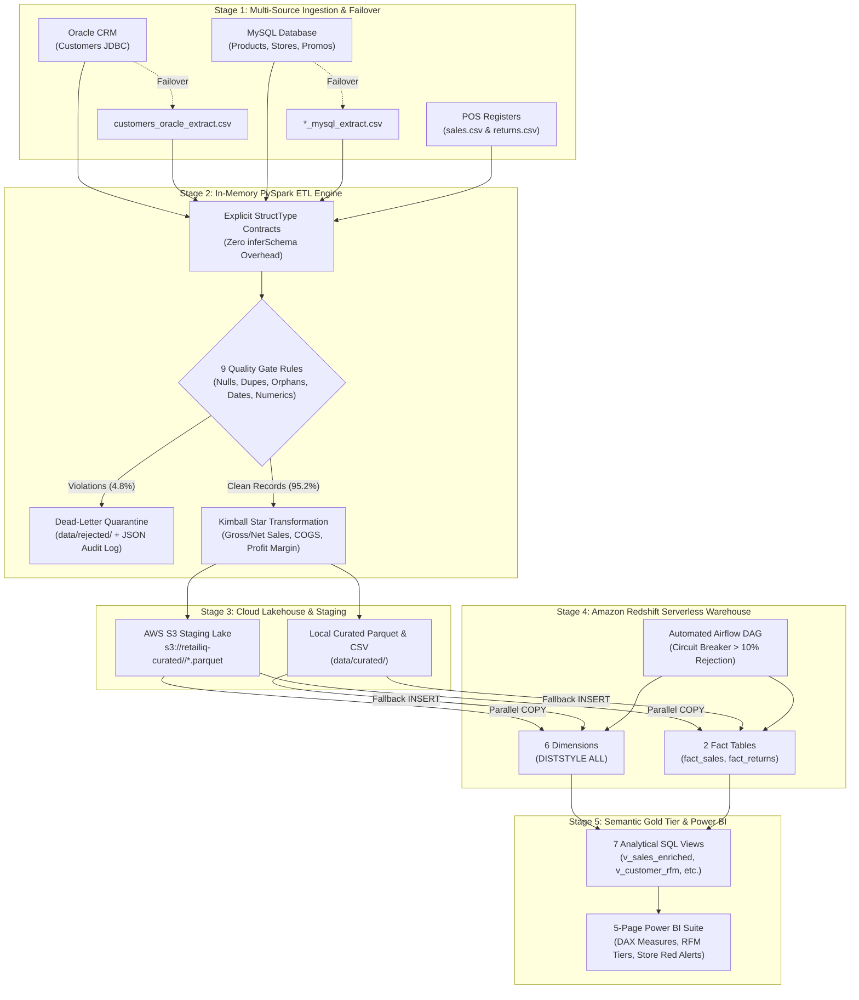
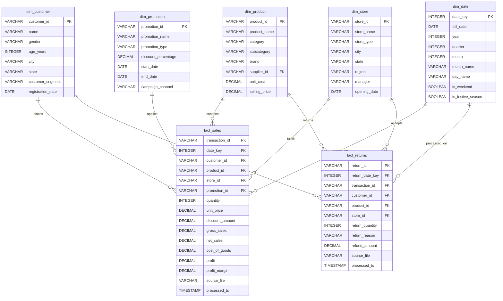

# 🛒 RetailIQ — Enterprise Retail Analytics & Data Platform 🚀

[](https://www.python.org/)
[](https://spark.apache.org/)
[](https://aws.amazon.com/redshift/)
[](https://aws.amazon.com/s3/)
[](https://airflow.apache.org/)
[](https://powerbi.microsoft.com/)
[](https://docs.pytest.org/)

**Cognizant NPN Hackathon — Use Case 5: Retail Sales Analytics & Customer Insights Platform**  
*A Zero-Data-Loss, Enterprise-Grade Hybrid ELT Architecture engineered for multi-source ingestion, in-memory distributed quality enforcement, cloud warehousing, and executive business intelligence.*

---

## 📌 Table of Contents

- [📊 Executive Business Problem \& KPI Scorecard](#-executive-business-problem--kpi-scorecard)
- [🏗️ High-Level System Architecture](#️-high-level-system-architecture)
- [🌟 Architectural Highlights \& Enterprise Patterns](#-architectural-highlights--enterprise-patterns)
- [🛡️ In-Memory Data Quality Engine \& Circuit Breaker](#️-in-memory-data-quality-engine--circuit-breaker)
- [📐 Kimball Star Schema Data Warehouse Design](#-kimball-star-schema-data-warehouse-design)
- [📂 Project Directory Structure](#-project-directory-structure)
- [⚡ Quickstart \& Local Execution Guide](#-quickstart--local-execution-guide)
  - [1. Prerequisites \& Environment Installation](#1-prerequisites--environment-installation)
  - [2. Automated Unit Test Verification](#2-automated-unit-test-verification)
  - [3. Generate Synthetic Enterprise Data](#3-generate-synthetic-enterprise-data)
  - [4. Execute PySpark ETL Pipeline](#4-execute-pyspark-etl-pipeline)
  - [5. Validate Data Warehouse Staging (Dry-Run)](#5-validate-data-warehouse-staging-dry-run)
- [☁️ Production Cloud Deployment (AWS \& Airflow)](#️-production-cloud-deployment-aws--airflow)
- [🖥️ Power BI Interactive Analytics Suite (5 Pages)](#️-power-bi-interactive-analytics-suite-5-pages)
- [📜 Analytical Semantic Tier (SQL Views \& KPIs)](#-analytical-semantic-tier-sql-views--kpis)
- [👥 Project Team \& Academic Credentials](#-project-team--academic-credentials)

---

## 📊 Executive Business Problem & KPI Scorecard

### The Business Challenge
In modern multi-channel retail, operational data is severely fragmented across siloed transactional engines:
1. **Customer Master Records** live in enterprise CRM databases (Oracle).
2. **Product Catalogs, Stores, Suppliers, and Promotions** reside in operational RDBMSs (MySQL).
3. **Daily Transactions and Returns** are generated at branch cash registers as high-volume POS flat feeds.
4. **Data Corruption & Margin Leakage:** Raw feeds suffer from missing foreign keys, negative discounts, cashier errors, duplicate scans, and unmonitored returns—leading to silent profit leakage and unreliable reporting.

### The RetailIQ Solution
RetailIQ ingests multi-source data with automatic database-to-CSV failover, evaluates **9 strict in-memory validation contracts** via PySpark, isolates corrupted transactions into a **Dead-Letter Quarantine** with audit logs, and loads clean data into an **Amazon Redshift Kimball Star Schema** feeding a **5-page Power BI executive suite**.

### Validated KPI Benchmark Summary
The pipeline processes 60,600 transactions with 2,200+ injected stress anomalies, producing verifiable executive KPIs with 100% audit precision:

| 💰 Total Net Revenue | 📈 Gross Profit | 🎯 Profit Margin % | 📦 Units Sold | 🔄 Return Rate % | 💵 Total Refunds |
|:---:|:---:|:---:|:---:|:---:|:---:|
| **₹2.76 Billion** | **₹768.06 Million** | **27.86%** | **93,751** | **5.48%** | **₹149.84 Million** |

| 👥 Unique Customers | 💳 Avg Spend / Customer | 🏬 Avg Revenue / Store | 🚀 YoY Benchmark Growth | 🛡️ Data Audit Precision | ⚡ Processing Quality |
|:---:|:---:|:---:|:---:|:---:|:---:|
| **7,992** | **₹344,915** | **₹137.83 Million** | **+108.33%** | **100% Audit Precision** | **95.2% Valid / 4.8% Quarantined** |

---

## 🏗️ High-Level System Architecture



---

## 🌟 Architectural Highlights & Enterprise Patterns

1. **Zero-Data-Loss Dead-Letter Architecture:**
   - Rejected transactions are never dropped silently. Rows failing schema or referential integrity rules are routed to `data/rejected/` with an attached `dq_reason` tag and logged in a timestamped JSON audit document (`_dq_log/*.json`).
2. **Explicit Schema Binding (No `inferSchema`):**
   - Ingestion enforces predefined Spark `StructType` definitions across all 7 sources. This eliminates runtime schema-inference overhead, detects schema drift instantly, and protects downstream tables from type corruption.
3. **Hybrid Ingestion with Automated Demo Failover:**
   - Production mode connects directly to live Oracle and MySQL instances via JDBC drivers.
   - If credentials are missing or databases are unreachable, the engine gracefully falls back to local CSV extracts without crashing or requiring code modifications.
4. **Massively Parallel Cloud Staging (AWS S3 to Redshift COPY):**
   - Curated data is exported as columnar, Snappy-compressed Parquet and CSV files.
   - For AWS Redshift, bulk loading uses native parallel S3 `COPY` commands across warehouse slices rather than slow iterative `INSERT` statements.
5. **Airflow Automated Circuit Breakers:**
   - An Apache Airflow DAG orchestrates the daily run at 02:00 AM IST.
   - A `BranchPythonOperator` acts as an automated circuit breaker: if the data rejection rate exceeds **10%**, the pipeline halts automatically before corrupted data can contaminate reporting layers.
6. **Optimized Kimball Star Schema:**
   - All 6 dimensions (`dim_customer`, `dim_product`, `dim_store`, `dim_supplier`, `dim_promotion`, `dim_date`) use `DISTSTYLE ALL` so dimension tables replicate across all Redshift compute nodes, completely eliminating shuffle cost on joins.
   - Fact tables (`fact_sales`, `fact_returns`) are partitioned and compound-sorted by transaction dates.

---

## 🛡️ In-Memory Data Quality Engine & Circuit Breaker

The PySpark validation engine enforces 9 distinct enterprise business and domain checks:

| Rule Name | Target Scope | Validation Condition | Rejection Reason | Handling Action |
|---|---|---|---|---|
| **Critical Field Null Check** | Sales & Returns | `transaction_id`, `product_id`, `customer_id`, or `store_id` is `NULL` | `null_critical_field` | Quarantined to `data/rejected/` |
| **Transaction ID Uniqueness** | Sales | Primary business key uniqueness | `duplicate_transaction_id` | Duplicate instances quarantined |
| **Product Referential Integrity** | Sales & Returns | Foreign key exists in `dim_product` master | `orphan_product` | Quarantined to `data/rejected/` |
| **Customer Referential Integrity** | Sales & Returns | Foreign key exists in `dim_customer` master | `orphan_customer` | Quarantined to `data/rejected/` |
| **Store Referential Integrity** | Sales & Returns | Foreign key exists in `dim_store` master | `orphan_store` | Quarantined to `data/rejected/` |
| **Numeric Domain Range Check** | Sales | `quantity > 0` and `unit_price >= 0` | `invalid_quantity` | Quarantined to `data/rejected/` |
| **Discount Threshold Gate** | Sales | `discount >= 0` and `discount <= (qty * unit_price)` | `invalid_discount` | Quarantined to `data/rejected/` |
| **Calendar Consistency Check** | Sales | `transaction_date <= CURRENT_DATE` and valid format | `invalid_transaction_date` | Quarantined to `data/rejected/` |
| **Return Temporal & Key Check** | Returns | `return_date >= transaction_date` and valid transaction linkage | `return_before_transaction` / `orphan_return` | Quarantined to `data/rejected/` |

---

## 📐 Kimball Star Schema Data Warehouse Design



---

## 📂 Project Directory Structure

```text
retail-iq/
├── .env.example                       # Environment template for AWS, Redshift, MySQL, Oracle
├── requirements.txt                   # Production Python package requirements
├── README.md                          # Comprehensive enterprise documentation
│
├── airflow/                           # Pipeline Orchestration
│   └── dags/
│       └── retailiq_etl_dag.py        # Nightly DAG with Circuit Breaker & XCom audit
│
├── config/                            # Central Configuration
│   ├── __init__.py
│   └── settings.py                    # Environment loader and connection state evaluators
│
├── data/                              # Data Staging Lakes
│   ├── raw/                           # Raw POS CSVs & CRM/MySQL extracts
│   ├── curated/                       # Curated Star Schema (Parquet & CSV)
│   │   ├── csv/                       # Single-part CSVs for Redshift COPY/INSERT
│   │   └── _dq_log/                   # JSON audit logs with per-rule violation counts
│   └── rejected/                      # Dead-letter quarantine (rejected_sales, rejected_returns)
│
├── data_quality/                      # In-Memory Validation Engine
│   ├── __init__.py
│   └── checks.py                      # 9 core validation routines on Spark DataFrames
│
├── docs/                              # Technical Specifications & Presentations
│   ├── architecture.md               # End-to-end data flow and architectural design
│   ├── data_dictionary.md            # Complete entity attributes, keys, and schemas
│   └── demo_script.md                # 15-minute live hackathon presentation playbook
│
├── etl/                               # Ingestion & Transformation Engine
│   ├── __init__.py
│   └── etl_pipeline.py                # PySpark ELT: Extract, Validate, Transform, Load
│
├── ingestion/                         # Ingestion Contracts
│   ├── __init__.py
│   └── schemas.py                     # Explicit Spark StructType contracts for 7 sources
│
├── powerbi/                           # BI Semantic Layer & Dashboards
│   ├── dashboard_build_guide.md       # Step-by-step visual creation guide
│   └── measures.dax                   # Centralized DAX measures (Time intelligence, RFM, KPIs)
│
├── redshift/                          # Cloud Data Warehouse
│   ├── ddl/
│   │   ├── 01_dimensions.sql          # Dimension tables with DISTSTYLE ALL
│   │   └── 02_facts.sql               # Fact tables with sort keys & compression
│   ├── analytics/
│   │   ├── views.sql                  # 7 Gold analytical SQL views
│   │   └── kpi_queries.sql            # 20 pre-tested KPI queries (Q01-Q20)
│   └── load/
│       └── load_redshift.py           # S3 parallel COPY loader with dry-run mode
│
├── scripts/                           # Tooling & Synthetic Data
│   └── generate_source_data.py        # 60K+ transaction generator with 2.2K injected issues
│
└── tests/                             # Automated Test Suite
    ├── __init__.py
    ├── test_data_quality.py           # Unit tests for validation functions on mock Spark DFs
    └── test_ingestion_schemas.py      # Unit tests verifying StructType contracts
```

---

## ⚡ Quickstart & Local Execution Guide

### 1. Prerequisites & Environment Installation

#### Runtimes Required:
- **Python 3.11+**
- **Java 17 (OpenJDK / Temurin)** (Required for Apache Spark runtime)
- **Hadoop Winutils** (Required on Windows for Spark native filesystem operations)

#### Setup Steps (PowerShell / Windows):
```powershell
# Clone the repository
git clone https://github.com/draxxycodes/retail-iq.git
cd retail-iq

# Configure Java and Hadoop environment paths
$env:JAVA_HOME = "C:\Program Files\Eclipse Adoptium\jdk-17.0.20.101-hotspot"
$env:HADOOP_HOME = "C:\Users\<username>\.winutils\hadoop-3.3.6"
$env:PATH = "$env:HADOOP_HOME\bin;$env:JAVA_HOME\bin;$env:PATH"

# Create virtual environment and install dependencies
python -m venv .venv
.venv\Scripts\activate
pip install -r requirements.txt
```

#### Setup Steps (Linux / macOS / Bash):
```bash
git clone https://github.com/draxxycodes/retail-iq.git
cd retail-iq
python3 -m venv .venv
source .venv/bin/activate
pip install -r requirements.txt
```

---

### 2. Automated Unit Test Verification

Validate schema contracts, null handling, duplicate detection, and referential checks across in-memory Spark sessions:

```bash
pytest tests/ -v
```

Expected result:
```text
tests/test_data_quality.py::test_check_nulls PASSED                      [  8%]
tests/test_data_quality.py::test_check_duplicates PASSED                 [ 16%]
tests/test_data_quality.py::test_check_referential PASSED                [ 25%]
tests/test_data_quality.py::test_check_numerics PASSED                   [ 33%]
tests/test_data_quality.py::test_check_dates PASSED                      [ 41%]
tests/test_data_quality.py::test_check_required_columns_raises PASSED    [ 50%]
tests/test_ingestion_schemas.py::test_all_source_files_have_registered_schemas PASSED [ 58%]
tests/test_ingestion_schemas.py::test_sales_schema_has_expected_column_types PASSED [ 66%]
tests/test_ingestion_schemas.py::test_returns_schema_has_expected_column_types PASSED [ 75%]
tests/test_ingestion_schemas.py::test_master_data_schemas_are_registered_correctly PASSED [ 83%]
tests/test_ingestion_schemas.py::test_required_field_lists_are_defined PASSED [ 91%]
tests/test_ingestion_schemas.py::test_registered_schemas_match_source_definitions PASSED [100%]

============================= 12 passed in 55.96s =============================
```

---

### 3. Generate Synthetic Enterprise Data

Generate 60,000+ realistic retail transactions, 3,600 returns, customer master records, and catalog files, complete with 2,200+ injected data quality anomalies:

```bash
python scripts/generate_source_data.py
```

Outputs written to `data/raw/`:
- `sales.csv` (60,600 rows)
- `returns.csv` (3,600 rows)
- `customers_oracle_extract.csv` (8,000 rows)
- `products_mysql_extract.csv` (240 rows)
- `stores_mysql_extract.csv` (20 rows)
- `suppliers_mysql_extract.csv` (12 rows)
- `promotions_mysql_extract.csv` (10 rows)
- `_injection_manifest.json` (The audit answer key)

---

### 4. Execute PySpark ETL Pipeline

Trigger the end-to-end extraction, validation, enrichment, and curation pipeline:

```bash
python etl/etl_pipeline.py
```

Console execution output:
```text
== 1. EXTRACT ==
  [CSV]  No JDBC credentials — using CSV fallback for all sources
extract  sales.csv                          60,600 rows  [CSV]
extract  returns.csv                         3,600 rows  [CSV]
extract  customers_oracle_extract.csv        8,000 rows  [CSV]
extract  products_mysql_extract.csv            240 rows  [CSV]
extract  stores_mysql_extract.csv               20 rows  [CSV]
extract  suppliers_mysql_extract.csv            12 rows  [CSV]
extract  promotions_mysql_extract.csv           10 rows  [CSV]
== 2. VALIDATE ==
== 3. TRANSFORM ==
== 4. LOAD (curated) ==
curated  dim_customer            8,000 rows  -> parquet + csv
curated  dim_product               240 rows  -> parquet + csv
curated  dim_store                  20 rows  -> parquet + csv
curated  dim_supplier               12 rows  -> parquet + csv
curated  dim_promotion              10 rows  -> parquet + csv
curated  dim_date                  754 rows  -> parquet + csv
curated  fact_sales             58,454 rows  -> parquet + csv
curated  fact_returns            3,486 rows  -> parquet + csv
rejected rejected_sales          2,953 rows
rejected rejected_returns          114 rows
dq log  -> data/curated/_dq_log/dq_log_20261013_031354.json
```

---

### 5. Validate Data Warehouse Staging (Dry-Run)

Validate all curated Star-Schema CSV files and DDL readiness without requiring active cloud credentials:

```bash
python redshift/load/load_redshift.py --dry-run
```

Expected result:
```text
Checking curated files ...
  dim_customer       -> data/curated/csv/dim_customer/part-*.csv
  dim_product        -> data/curated/csv/dim_product/part-*.csv
  dim_store          -> data/curated/csv/dim_store/part-*.csv
  dim_supplier       -> data/curated/csv/dim_supplier/part-*.csv
  dim_promotion      -> data/curated/csv/dim_promotion/part-*.csv
  dim_date           -> data/curated/csv/dim_date/part-*.csv
  fact_sales         -> data/curated/csv/fact_sales/part-*.csv
  fact_returns       -> data/curated/csv/fact_returns/part-*.csv
DRY RUN: files OK, no database writes.
```

---

## ☁️ Production Cloud Deployment (AWS & Airflow)

To run the pipeline against a live AWS Redshift Serverless cluster and S3 Data Lake:

### 1. Configure `.env` Credentials
Copy `.env.example` to `.env` and supply your infrastructure secrets:

```ini
# Amazon Redshift Serverless
REDSHIFT_HOST=default-workgroup.xxxxxxxxxxxx.ap-south-1.redshift-serverless.amazonaws.com
REDSHIFT_PORT=5439
REDSHIFT_DATABASE=dev          # Serverless default DB; the 'retailiq' schema is created inside it
REDSHIFT_USER=admin
REDSHIFT_PASSWORD=YourSecurePassword123!

# AWS S3 Staging Lake
S3_BUCKET=retailiq-staging-xxxxxxxxxxxx
S3_PREFIX=retailiq/curated
REDSHIFT_IAM_ROLE=arn:aws:iam::xxxxxxxxxxxx:role/RetailIQRedshiftS3Role
AWS_REGION=ap-south-1

# Operational Databases (Optional: if omitted, CSV failover activates)
MYSQL_HOST=mysql-db.internal.net
MYSQL_USER=inventory_reader
MYSQL_PASSWORD=SecurePassword!
ORACLE_HOST=oracle-crm.internal.net
ORACLE_USER=crm_reader
ORACLE_PASSWORD=SecurePassword!
```

### 2. Deploy Warehouse DDL & Parallel S3 COPY
```bash
# Full load: uploads CSVs to S3, then COPYs into Redshift, then compiles views
python redshift/load/load_redshift.py --apply-views

# If CSVs are already staged in S3 (e.g., from Airflow upload_to_s3 task):
python redshift/load/load_redshift.py --skip-upload --apply-views
```

Expected production output:
```text
Loading mode: S3 COPY (bucket=retailiq-staging-601699043157)
Applying 01_dimensions.sql ...
Applying 02_facts.sql ...
Loaded dim_customer          8,000 rows
Loaded dim_product             240 rows
Loaded dim_store                20 rows
Loaded dim_supplier             12 rows
Loaded dim_promotion            10 rows
Loaded dim_date                754 rows
Loaded fact_sales           58,454 rows
Loaded fact_returns          3,486 rows
Row counts in warehouse:
  dim_customer          8,000
  dim_product             240
  dim_store                20
  dim_supplier             12
  dim_promotion            10
  dim_date                754
  fact_sales           58,454
  fact_returns          3,486
Applying analytical views (views.sql) ...
Analytical views compiled successfully.
LOAD COMPLETE
```

This script automatically:
1. Connects via `psycopg2` using SSL (`sslmode=require`).
2. Applies `redshift/ddl/01_dimensions.sql` and `redshift/ddl/02_facts.sql` (idempotent `DROP … CASCADE`).
3. Uploads curated CSVs to S3 (or skips if `--skip-upload`).
4. Executes native parallel Redshift `COPY … IAM_ROLE … CSV` commands.
5. Compiles 7 analytical views via `--apply-views`.

### 3. Deploy Apache Airflow DAG
1. Copy `airflow/dags/retailiq_etl_dag.py` to your Airflow `$AIRFLOW_HOME/dags/` folder.
2. In the Airflow UI, define Variable `RETAILIQ_PROJECT_ROOT` pointing to your repository directory.
3. The DAG runs daily at **02:00 AM IST** with automated retries and circuit breaker validation.

---

## 🖥️ Power BI Interactive Analytics Suite (5 Pages)

The analytical tier exposes 5 executive report pages (detailed in [powerbi/dashboard_build_guide.md](file:///c:/Users/priya/OneDrive/Documents/retail-iq/powerbi/dashboard_build_guide.md)):

```text
 ┌───────────────────────┐   ┌───────────────────────┐   ┌───────────────────────┐
 │ Page 1: Executive KPI │   │ Page 2: Store Geo Map │   │ Page 3: Customer RFM  │
 │ - Net Revenue ₹2.76B  │   │ - State-by-State Map  │   │ - 7 Behavioral Tiers  │
 │ - Profit ₹768.06M     │   │ - Store Tier Analysis │   │ - Champions vs Lost   │
 │ - YoY Monthly Trend   │   │ - Red Alert Refund >8%│   │ - At-Risk Data Bars   │
 └───────────────────────┘   └───────────────────────┘   └───────────────────────┘
                 ┌───────────────────────┐   ┌───────────────────────┐
                 │ Page 4: Assortment    │   │ Page 5: Returns/Promo │
                 │ - Top 10 Revenue Stars│   │ - ₹149.8M Refund Leak │
                 │ - Bottom 10 Bleeders  │   │ - Return Reason Split │
                 │ - Margin vs Rev Bubble│   │ - Markdown Uplift Rate│
                 └───────────────────────┘   └───────────────────────┘
```

- **Page 1: Executive Overview:** High-level performance scorecard (Revenue, Gross Profit, Profit Margin %, Units Sold, Return Rate %, Average Order Value, and YoY growth benchmark +108.33%).
- **Page 2: Sales & Stores:** State-by-state Indian revenue geospatial map, Flagship vs. Standard vs. Express store-tier profitability, and store rankings with automated **Red Alerts** for branches where `refund_rate > 8%`.
- **Page 3: Customer Insights (RFM Segmentation):** Customer behavioral segmentation into 7 distinct tiers (*Champions, Loyal, Potential Loyalists, New Customers, About to Sleep, At Risk, Lost*). Features an At-Risk Retention Table with in-cell red data bars mapped to `recency_days`.
- **Page 4: Products & Assortment:** Ranks the Top 10 Revenue Generators against the Bottom 10 Profit Bleeders (delist candidates), category return matrices, and a four-quadrant Margin vs. Revenue scatter plot.
- **Page 5: Promotions & Returns:** Audits promotional campaign ROI, analyzes reverse logistics leakage (₹149.84M in refunds), and classifies return drivers (*Defective, Wrong Size, Changed Mind, Damaged in Transit, Not as Described*).

---

## 📜 Analytical Semantic Tier (SQL Views & KPIs)

All reporting layers consume 7 pre-aggregated Gold SQL views in [redshift/analytics/views.sql](file:///c:/Users/priya/OneDrive/Documents/retail-iq/redshift/analytics/views.sql):

1. `v_sales_enriched` — De-normalized sales base pre-joining all 6 dimensions.
2. `v_daily_kpi` — Daily rollup of revenue, cost, profit, orders, and customer activity.
3. `v_customer_rfm` — Recency, Frequency, Monetary NTILE(5) scoring and 7-tier segment mapping.
4. `v_product_performance` — Product-level margin, units sold, revenue, and return rate.
5. `v_store_performance` — Store-tier ranking, geographic metrics, and refund ratios.
6. `v_promotion_performance` — Campaign uplift, discount cost, and promotional net margin.
7. `v_returns_analysis` — Return root-cause analysis joined with product categories and stores.

---

## 👥 Project Team & Academic Credentials

**Use Case 5 — Retail Sales Analytics & Customer Insights Platform**  
**Hackathon:** Cognizant NPN Hackathon / Industry Track

- **Punyasila Mohanty** — Project Lead & Strategy
- **Chinmaya Kumar Rout (Chinu)** — Data Architect & Pipeline Lead  
- **Sairush Sahoo** — Data Ingestion Engineer
- **Sreyash Lenka** — ETL & Data Quality Engineer
- **Priyabrata Dash** — Cloud Data Warehouse & DevOps Engineer
- **Om** — Orchestration Engineer
- **Aurokalyan** — BI Analyst & Visualization Lead

**Mentor:** Satyabrata Tripathy  
**Institution:** Institute of Technical Education and Research (ITER)  
**University:** Siksha 'O' Anusandhan (Deemed to be University), Bhubaneswar, Odisha  
**Department:** Department of Computer Science & Engineering
